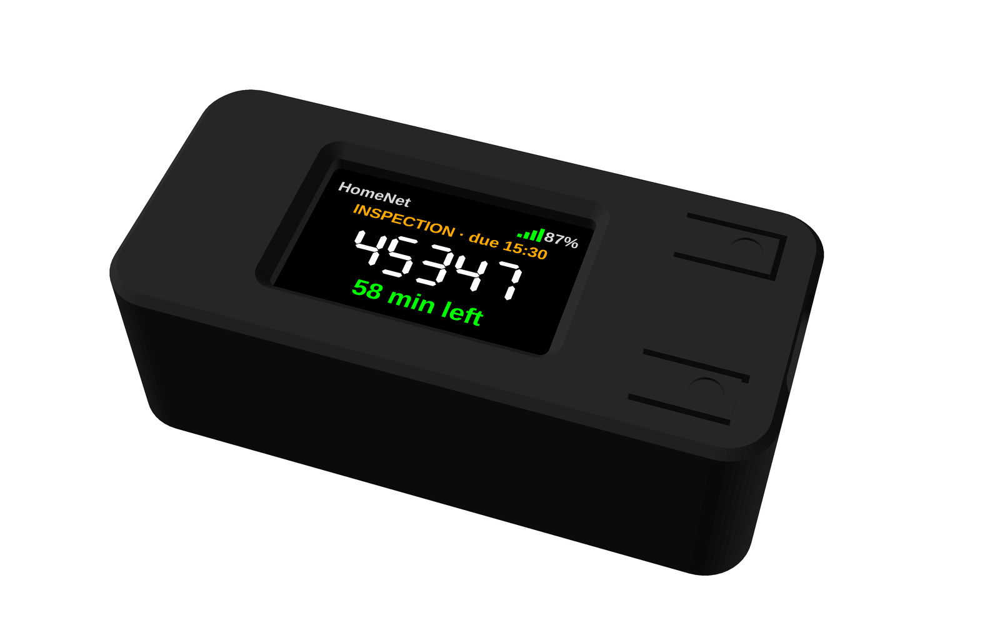
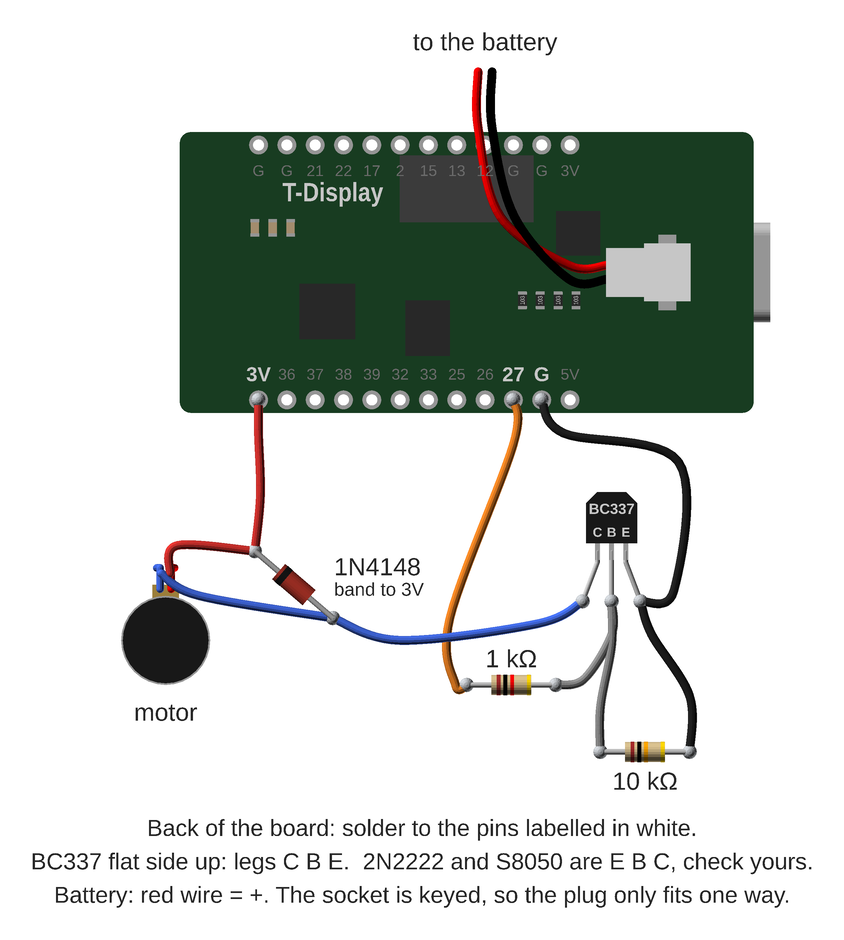

# PrufLock

*A badge for lazy subs.*



I'm a lazy sub. Every time my keyholder ordered an inspection in [ChastityTracker](https://www.chastitytracker.ch), I had to scribble the code onto a post-it, hold it into the proof photo, and hope my handwriting was readable. Every single time. So I built a little gadget that does the scribbling for me.

PrufLock stays dark and quiet in your pocket. When an inspection comes in, it buzzes, lights up and shows the code, the deadline and how much time you have left. Hold it into the photo, send it, and the badge goes back to sleep. No pens, no post-its.

## What you need

- A **ChastityTracker** account (version 6.4.0 or newer). The easy way is a free hosted instance from [chastitytracker.ch](https://www.chastitytracker.ch); you can also [host your own](https://github.com/trublue-2/chastitytracker).
- A **LilyGO TTGO T-Display v1.1** (ESP32 with a 1.14" display). Leave the pin headers unsoldered.
- A **LiPo battery** that fits behind the board: a 3.7 V pouch cell of size **602158** (6.0 × 21 × 58 mm, about 750 mAh). It needs a 2-pin **JST 1.25 mm** plug to fit the board's socket; many cells come with a larger one.
- Optional: a **vibration motor** and a few parts, see [below](#vibration-motor-optional).
- A **3D-printed case**, with a belt clip or without one (then with a two-colour logo on the back): files and assembly notes are in [`case/`](case/README.md).

## Install the firmware

The easiest way is the browser:

1. Connect the board with a USB-C data cable.
2. Open the **[PrufLock flasher](https://lockedsub.github.io/pruflock/)** in Chrome or Edge and click *Install firmware*.
3. Pick the serial port. If none shows up, install the [CP210x driver](https://www.silabs.com/developer-tools/usb-to-uart-bridge-vcp-drivers).

When updating a badge that's already set up, don't erase it: it keeps its settings. The images are also on the [releases page](https://github.com/Lockedsub/pruflock/releases), for `esptool.py write_flash 0x0 pruflock-<version>.bin`.

**Building it yourself** takes [PlatformIO](https://platformio.org):

```bash
pio run -t upload
```

```bash
pio device monitor
```

The first build downloads the [pioarduino](https://github.com/pioarduino/platform-espressif32) platform (Arduino-ESP32 3.x).

## Setup

1. Switch the badge on. The first time, it starts setup by itself; later, **hold the lower button (B) for 3 s**. The display shows a Wi-Fi name, `PrufLock`, and a password.
2. Join that Wi-Fi with your phone.
3. The setup page opens by itself. If it doesn't, open **http://192.168.4.1** in the browser.
4. Enter up to 3 Wi-Fi networks (home, phone hotspot, …), your ChastityTracker server (e.g. `tracker.example.com`) and the wearer's login. Pick English or Deutsch.
5. Tap **Save & restart**. The badge logs in, and you're done.

Once the badge is set up, a button press leaves setup without changes (the first setup can't be skipped). **Erase all settings** at the bottom of the page resets the badge to factory state.

## Using the badge

| What you see | What it means |
|---|---|
| Nothing (dark) | No inspection pending. The badge checks every minute. |
| `INSPECTION` and a code | Time for a photo! The deadline is on top, the time left below: green, yellow under 30 min, red when overdue. `+1` means more inspections are waiting. The badge checks every 30 s and dims after 5 min. |
| `Done` | The inspection is done (photo received, or withdrawn). Back to sleep. |

- **Press A or B** to wake the badge and check right away. With nothing pending, you get a status screen for 30 s: Wi-Fi, battery, locked or unlocked, and your username. Any button ends it.
- With a code on screen, **A** checks again and **B** just lights the screen up; both stop the reminders.
- **Hold B for 3 s** to open setup.
- With a motor fitted, the badge buzzes 3× for each new inspection and again every 5 min until you press a button.

## Vibration motor (optional)

So you don't miss an inspection, the badge can buzz like a phone. Without a motor, it works the same, just silently.

- **Motor:** a 3 V vibration motor drawing about 80 mA, e.g. the TRU COMPONENTS TC-13324648 coin motor (Ø8 × 2 mm).
- **Driver:** NPN transistor BC337 (or 2N2222 / S8050), resistors 1 kΩ and 10 kΩ, diode 1N4148. Never connect a motor straight to a pin: it draws more current than a pin can supply, and its voltage spike would damage the pin.

```
3V ──────┬────────────┐
         │           (M)  motor
   1N4148│ cathode    │
   to 3V ▲            │
         └────────────┤
                      C
GPIO27 ── 1 kΩ ──── B   BC337
              │       E
            10 kΩ     │
              │       │
GND ──────────┴───────┘
```

Solder it to the pin holes marked `3V`, `G` and `27`. The badge gives one short buzz at power-up, so you know the wiring works.



The picture shows the back of the board. Solder the wires from that side and cut them flush on the front: in the case, the board's front rests on ribs along the rows of pins, so nothing may stick out there.

## Troubleshooting

- **The setup page doesn't open on an iPhone.** iOS waits about 45 s before showing it. Open http://192.168.4.1 in the browser instead (type the address, not a name). If it never appears, forget `PrufLock` in Settings → Wi-Fi and join again.
- **The badge can't find the iPhone hotspot.** Turn on **Maximize Compatibility** in Settings → Personal Hotspot (the badge only speaks 2.4 GHz). An idle hotspot hides itself: open the hotspot page on the phone and press a button on the badge.
- **`Login rejected`:** the username or password is wrong. The badge doesn't retry on its own, to avoid locking the account, and shows this every 15 min. Fix it in setup, or press a button for one more try.
- **`Login blocked`:** the server refused logins for a while (too many attempts). The badge waits 30 min before it tries again.
- **`Inspection pending`, but `no code – see app`:** the inspection needs no code, or the server is older than 6.4.0.
- **Anything else:** connect USB and open the serial monitor (115200 baud). Every step is logged, e.g. `[open] 1 inspections, code …`.

Curious how it works inside? See [docs/internals.md](docs/internals.md).

## Security

- Wi-Fi passwords and the wearer's password are stored **unencrypted** on the badge. Anyone with the badge and a USB cable can read them. Use **Erase all settings** before giving a badge away.
- The setup Wi-Fi uses WPA2 with a random password that's shown only on the display, and it's open only while setup runs (at most 10 min; on a badge that isn't set up yet, setup starts over until it's saved).
- The badge talks only to your server, over HTTPS with certificate checks, and to public time servers (NTP).

## License

Everything is [MIT](LICENSE): firmware, tools and case. Except the font: Liberation Sans, [SIL OFL 1.1](tools/fonts/LiberationSans-LICENSE.txt).

PrufLock is an independent project and contains no ChastityTracker code.
