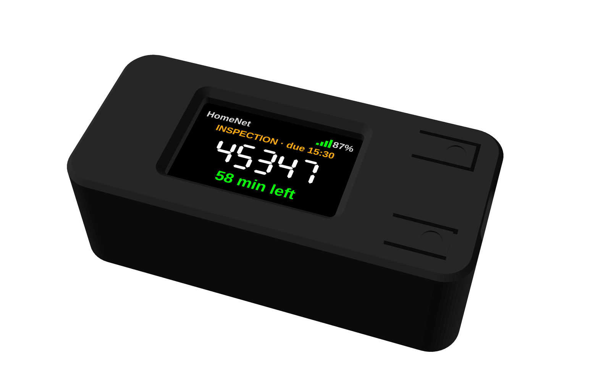
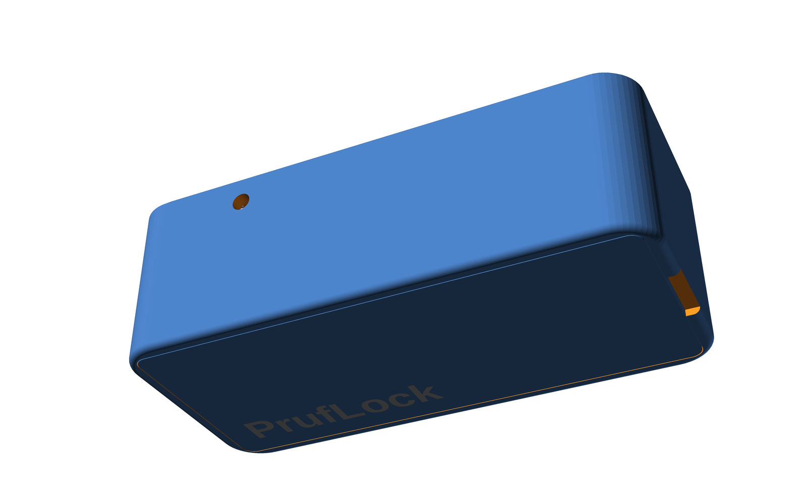
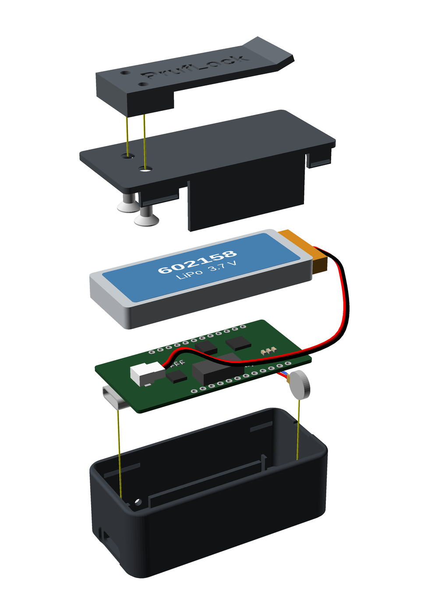
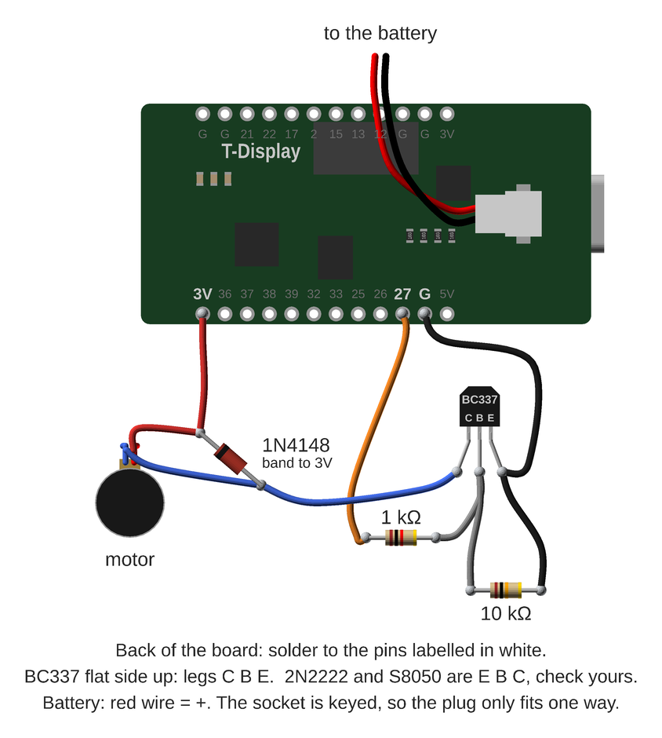

# PrufLock case



A snug pocket case for the TTGO T-Display, the LiPo and the coin vibration motor: **62 × 29 × 21 mm**, with a belt clip or without one for carrying in a bag. It's a parametric [OpenSCAD](https://openscad.org) model ([`pruflock_case.scad`](pruflock_case.scad), needs the [BOSL2](https://github.com/BelfrySCAD/BOSL2) library; the exploded view also needs [NopSCADlib](https://github.com/nophead/NopSCADlib)). The board dimensions come from LilyGO's [STEP model](https://github.com/Xinyuan-LilyGO/TTGO-T-Display/tree/master/3d_file).

## Printing

There are two versions: **with a belt clip**, or **without a clip** for carrying it in a bag, with "PrufLock" inlaid in the lid in a second colour. The shell is the same for both.

The easiest way is a 3MF with all parts on one plate, already in print orientation:

- [`PrufLock Case.3mf`](PrufLock%20Case.3mf): shell and lid, without clip. The lid is one object with two parts, "Lid" and "Logo".
- [`PrufLock Case with Clip.3mf`](PrufLock%20Case%20with%20Clip.3mf): shell, lid and clip.

Bambu Studio gives the logo the second filament by itself (OrcaSlicer, which reads the same settings, should too): pick grey for it. The logo is just the lid's first layer, so it costs a single colour change. On a single-colour printer, set the logo to the first filament too. Other slicers may load the lid with its logo as one part; it then simply prints in one colour.

The single parts are also there as STL:

| Part | File | Print orientation |
|---|---|---|
| Shell (front, walls, buttons) | `stl/shell.stl` | front face down |
| Lid for the clip (snaps in from the back) | `stl/lid.stl` | outer face down |
| Clip (belt/pocket) | `stl/clip.stl` | on its side |



Print in **PETG**, without supports, in the orientation of the files: 0.4 mm nozzle, 0.2 mm layers, 3 perimeters. The snap tongues, lid rails and clip spring need PETG's toughness.

PETG likes to string. Clear any strings out of the button slots and the window bevel, or the buttons won't move freely.

## Assembly



The exploded view shows where each part goes, with the shell front face down. Fit the clip to the lid first (step 1), even though it's drawn at the top.

1. **Clip** (skip this without the clip): screw it to the lid from the inside with two **M3 × 6 countersunk screws** (longer ones poke through on the belt side), or glue it on. Do this before the battery goes in.
2. **Motor:** stand the coin motor on its edge in the slot at the far end (opposite the USB socket), flat face against the end wall, leads toward the side. Stick it on with its adhesive pad, or glue it with epoxy. It only buzzes properly when it's glued firmly.
3. **Board:** insert it display first, USB-C into its opening. It rests on the edge ribs, so the pin headers must stay **unsoldered**.
4. **Driver:** solder the transistor, resistors and diode dead-bug style, as in the picture below, and wrap them in heat-shrink tubing. Lay them flat in the 3 mm gap between the board and the battery.

   

5. **Battery:** put it behind the board, with the end the wires come out of at the far end, with foam tape if you like. Route the wires along the side (2.2 mm of room) and plug them into the white socket on the back of the board, which opens toward the far end.
6. **Lid:** press it in until both snap tongues click. To open it again, put a fingernail or coin into the notch at the far end.

The reset button is a pinhole in the long side: use a paper clip.

## Adjusting the fit

All parameters are at the top of the `.scad` file.

| Problem | Parameter |
|---|---|
| Board too tight or too loose | `play` (0.15 per side, lengthwise and across) |
| Coin motor doesn't fit its slot (thicker than 2 mm) | `coin_t` (2.0), `coin_clr` (0.5 = slot play) |
| Lid too stiff or doesn't hold | `snap_bump` (0.5), `lid_clr` (0.10) |
| Buttons press too easily / not at all | `nub_gap` (0.25 = travel before contact), `tab_t` (0.9 = flexure thickness), `tab_tip` (2.6 = flexure end past the switch) |
| Gap above the display, or display pressed too hard | `disp_rest_h` (1.4 = frame height behind the window) |
| Window doesn't sit over the display | `win_c` (X offset −4.95), `win` |
| Rounder or squarer corners | `r_corner` (4.8 = outer radius), `r_cav` (1.6 = cavity radius, at most 1.7, or the board's corners hit the wall at the USB end) |
| Clip too tight or too loose | `belt_t` (4.5 = belt thickness) |
| No clip, logo on the lid instead | `with_clip` (true); the logo's `logo_t` (0.2 = depth, one layer) and `logo_size` (4.2), `logo_margin` (3 = distance from the lid's edges) |
| Motor driver (BC337, resistors) doesn't fit behind the board, or the case is thicker than needed without a motor | `parts_gap` (3.0 = space between the board's back and the battery; 0 without a motor) |

After a change, regenerate the STLs, the 3MFs and the preview images:

```bash
./build.sh
```

To look at a single part in the OpenSCAD GUI, set `part` at the top of the file (`assembly`, `shell`, `lid`, `clip`, `section`, `illustration`, `explode`).

## Tips

- The ESP32's antenna sits at the board's far end, right next to the motor. If the Wi-Fi bars on the status screen drop with the motor fitted, glue the motor to the inside of the lid instead.
- The charge LED is on the back of the board and can't be seen through the case. The battery level is on the display.

## License

The case model and printable parts are under the project's [MIT license](../LICENSE).
